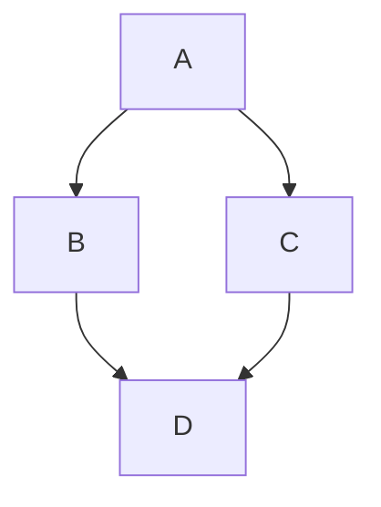

# 🐙 Formatações avançadas

## Alertas

Alertas são uma extensão Markdown baseada na sintaxe blockquote que você pode usar para enfatizar informações críticas. Eles são exibidos com cores e ícones distintos para indicar a importância do conteúdo.

> [!NOTE]
> Informação útil que os leitores devem saber, mesmo quando só passam os olhos pelo conteúdo.

> [!TIP]
> Dica para fazer algo de um jeito melhor ou mais fácil.

> [!IMPORTANT]
> Informação essencial para o leitor alcançar o objetivo.

> [!WARNING]
> Aviso urgente que exige atenção imediata para evitar problemas.

> [!CAUTION]
> Alerta sobre riscos ou consequências negativas de uma ação.

Para usar, escreva `> [!NOTE]` (ou `TIP`, `IMPORTANT`, `WARNING`, `CAUTION`) na primeira linha do bloco e o texto na linha seguinte, também começando com `>`.

## Seção recolhida

Você pode recolher temporariamente seções do seu Markdown criando uma seção expandida que o leitor pode optar por expandir. Por exemplo, quando você deseja incluir detalhes técnicos em um comentário do problema que pode não ser relevante ou interessante para todos os leitores, você pode colocar esses detalhes em uma seção recolhida.

Qualquer Markdown dentro do bloco `<details>` estará recolhido até que o leitor clique em ▶ para expandir os detalhes.

No bloco `<details>`, use a marca `<summary>` para que os leitores saibam o que está dentro dele. O rótulo aparece à direita de ▶.

<details>

<summary>Dicas para seções recolhidas</summary>

### Você pode adicionar um título

Você pode adicionar texto dentro de uma seção recolhida.

Também pode adicionar uma imagem ou um bloco de código.

```ruby
puts "Olá, mundo!"
```

</details>

O código acima é escrito assim:

````md
<details>

<summary>Dicas para seções recolhidas</summary>

### Você pode adicionar um título

Você pode adicionar texto dentro de uma seção recolhida.

</details>
````

> [!IMPORTANT]
> Deixe uma linha em branco depois de `</summary>` e outra antes de `</details>`. Sem elas, o Markdown de dentro do bloco pode não ser renderizado.

## Diagramas do Mermaid

O Mermaid é uma ferramenta inspirada em Markdown que transforma texto em diagramas. Por exemplo, o Mermaid pode interpretar gráficos de fluxo, diagramas de sequência, gráficos de pizza e muito mais.

Para criar um diagrama do Mermaid, adicione a sintaxe do Mermaid dentro de um bloco de código isolado com o identificador de linguagem `mermaid`.

Por exemplo, você pode criar um fluxograma especificando valores e setas:



## Mapas

É possível usar a sintaxe GeoJSON ou TopoJSON para criar mapas interativos. Para criar um mapa, adicione GeoJSON ou TopoJSON em um bloco de código protegido com o identificador de sintaxe `geojson` ou `topojson`.

```geojson
{
  "type": "FeatureCollection",
  "features": [
    {
      "type": "Feature",
      "id": 1,
      "properties": {
        "ID": 0
      },
      "geometry": {
        "type": "Polygon",
        "coordinates": [
          [
            [
              -90,
              35
            ],
            [
              -90,
              30
            ],
            [
              -85,
              30
            ],
            [
              -85,
              35
            ],
            [
              -90,
              35
            ]
          ]
        ]
      }
    }
  ]
}
```
